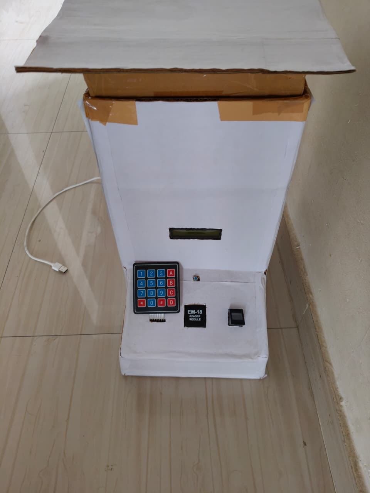
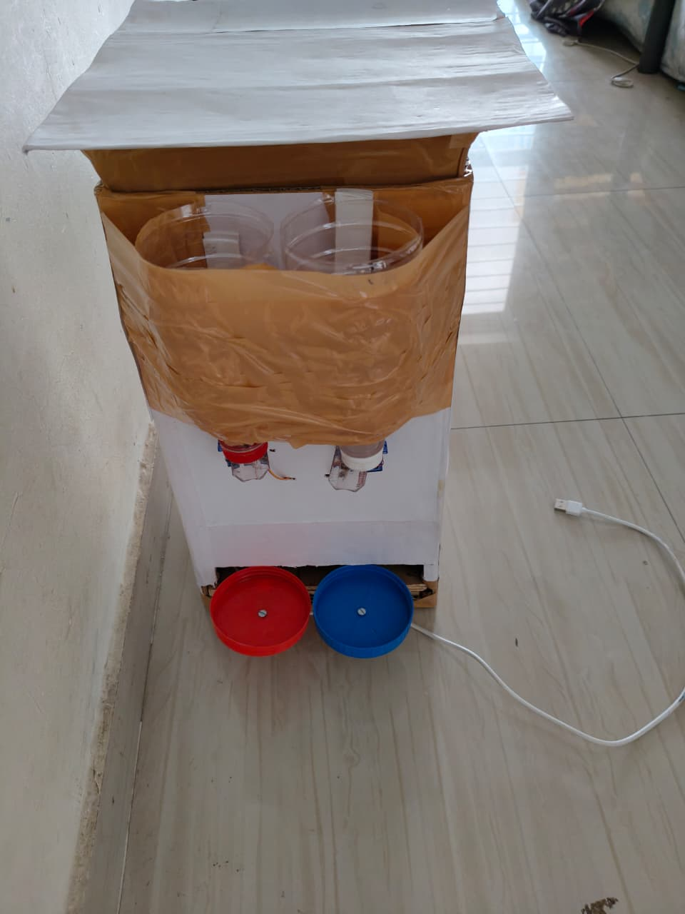
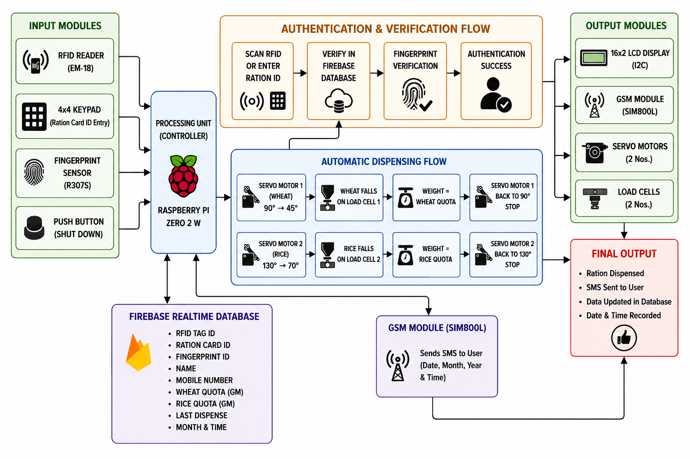
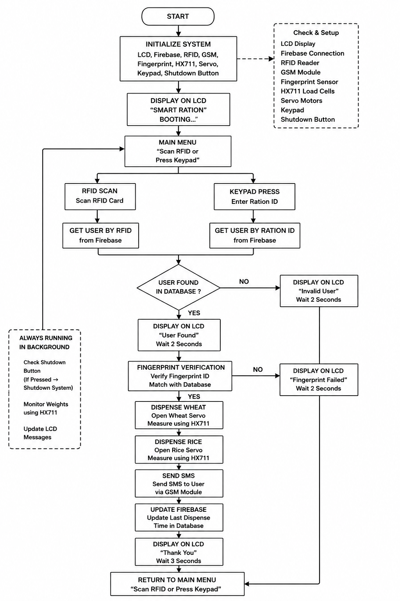
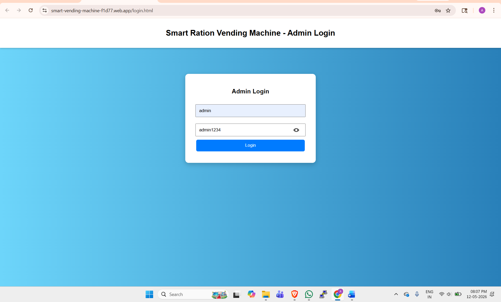
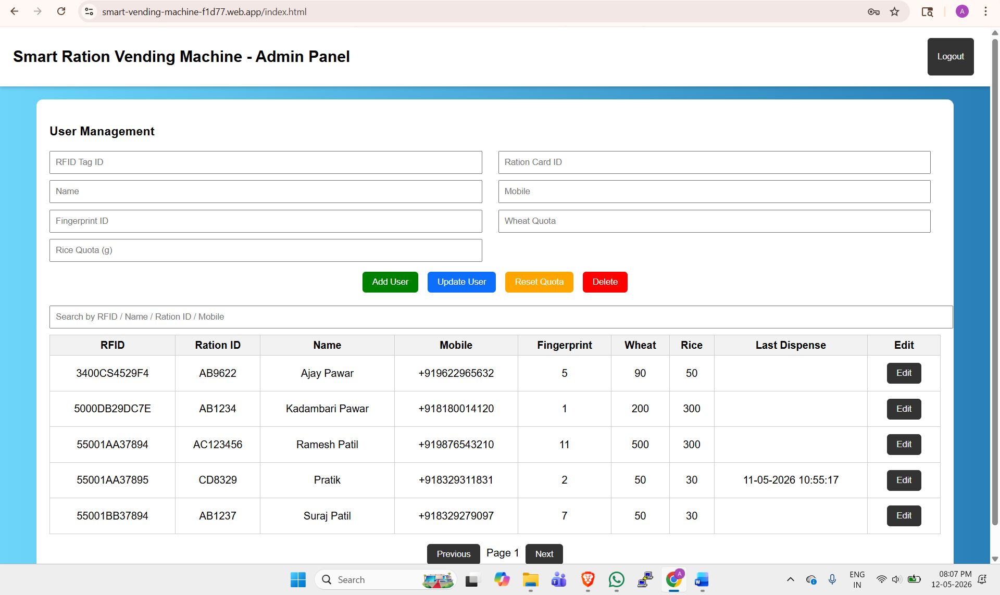
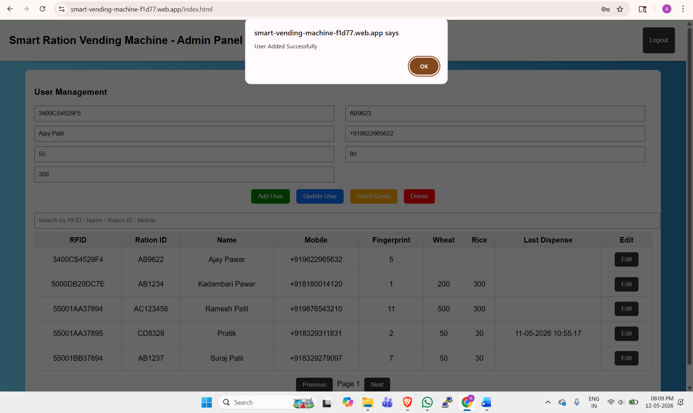
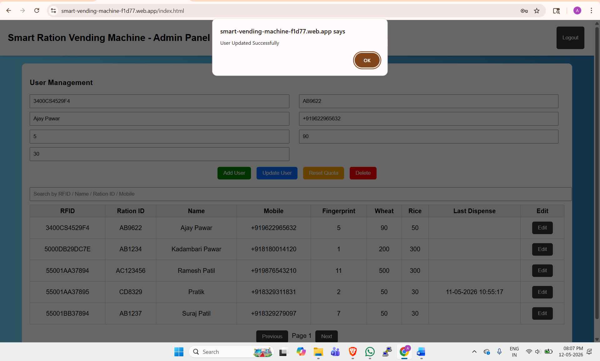
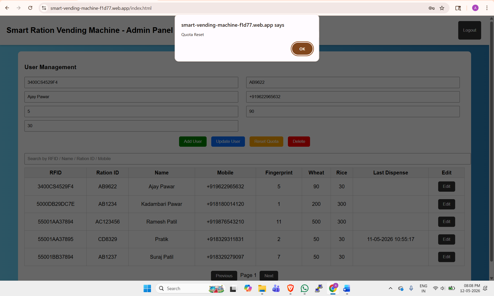
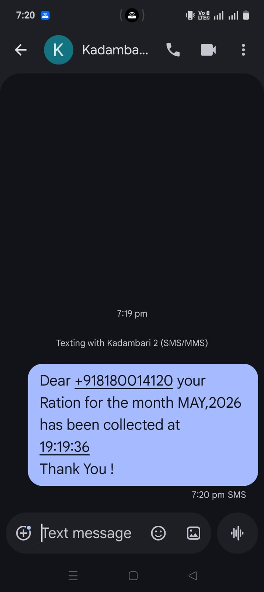

# Smart Ration Vending Machine 🌾

An automated, IoT-based public ration dispensing system built on a Raspberry Pi Zero 2 W. Beneficiaries authenticate with an RFID card **or** fingerprint, and the machine automatically dispenses their exact monthly wheat and rice quota by weight — no manual measuring, no ledger, no queue at a counter. Every dispense is logged to Firebase in real time and confirmed to the beneficiary by SMS.

This was built as a working prototype (housed in a cardboard enclosure) to validate the full electronics + software pipeline before a production enclosure.

<p align="center">
  
  
</p>

🔗 **Live demo:** [smart-vending-machine-f1d77.web.app](https://smart-vending-machine-f1d77.web.app/login.html) *(admin: `admin` / `admin1234` — demo credentials, see security note below)*

## Why

India's Public Distribution System (PDS) still relies heavily on manual verification and hand-measured quotas at ration shops, which is slow and vulnerable to short-weighing and identity fraud. This project explores a low-cost, unattended dispensing kiosk that verifies identity two ways (RFID + fingerprint), weighs each dispense with load cells for accuracy, and gives both the beneficiary (via SMS) and the administrator (via a live dashboard) a transparent, timestamped record.

## Features

- **Dual-factor authentication** — RFID card scan or manual ration card number entry (4x4 keypad), followed by fingerprint verification
- **Weight-accurate dispensing** — two servo-controlled hoppers (wheat + rice), each monitored by an independent HX711 + load cell so dispensing stops the instant the correct quota (in grams) is reached
- **Real-time database** — every user record, quota, and dispense timestamp is synced to Firebase Realtime Database
- **SMS confirmation** — GSM module (SIM800L) texts the beneficiary the moment their ration is dispensed, with the exact date and time
- **Live LCD feedback** — 16x2 I2C display walks the user through each step (scan → verify → dispensing → done)
- **Web admin panel** — add/update/delete beneficiaries, search by RFID/name/ration ID/mobile, reset quotas, and view last-dispense history, all synced live via Firebase
- **Safe power on/off** — physical push button for a clean shutdown sequence

## How It Works

1. LCD shows "Smart Vending Machine" for 2 seconds, then prompts continuously: *scan RFID or enter ration card number*
2. User either scans their RFID tag or types their ration card number on the keypad (entry echoed live on the LCD)
3. Once the ID matches a record in Firebase, the system moves to **fingerprint verification** against the R307S sensor's onboard memory
4. On success:
   - Servo 1 rotates from its resting position (90°) to 45°, releasing wheat from the hopper onto load cell 1
   - Dispensing stops automatically once the measured weight matches the user's stored `wheat_quota`, and the servo returns to 90°
   - Servo 2 then rotates from 130° to 70° to dispense rice, stopping at the stored `rice_quota` before returning to rest
5. The Pi fetches the real-time clock, sends an SMS via the GSM module, and writes the dispense timestamp back to Firebase

**SMS format:**
```
Dear <mobile number> your Ration for the month <MONTH NAME>,<YEAR> has been collected at <HH:MM:SS>

Thank You !
```

## System Architecture

**Block diagram** — input modules, processing unit, authentication flow, automatic dispensing flow, and output modules:

<p align="center">
  
</p>

**Software flowchart** — full control loop from boot to dispense:

<p align="center">
  
</p>

## Results

The admin panel is deployed on Firebase Hosting and tested end-to-end against the live Realtime Database — adding, editing, and resetting users all update the table instantly.

<p align="center">
  
</p>
<p align="center">
  
</p>
<p align="center">
  
  
  
</p>

**SMS confirmation received on dispense**, matching the format defined for the project:

<p align="center">
  
</p>

🎥 A full demo video of the hardware + dashboard working together is at [`demo/demo-video.mp4`](demo/demo-video.mp4).

## Firebase Realtime Database Schema

```
users/
  <RFID_TAG_ID>/
    ration_card_id
    fingerprint_id
    name
    mobile
    wheat_quota
    rice_quota
    last_dispense_time
```

## Hardware

| Component | Purpose |
|---|---|
| Raspberry Pi Zero 2 W | Main controller |
| R307S fingerprint sensor | Second-factor biometric verification |
| EM-18 RFID reader | Card-based identification |
| 4x4 matrix keypad | Manual ration card entry |
| 16x2 LCD (I2C) | User-facing status display |
| 2x load cell + HX711 | Precision weight measurement (wheat, rice) |
| 2x servo motor | Hopper gate control |
| SIM800L GSM module | SMS notifications |
| DS1307 RTC | Accurate timestamps |
| Push button | Safe power on/off |

Full wiring reference: [`docs/pin-connections.md`](docs/pin-connections.md)

## Admin Panel

A browser-based dashboard for managing beneficiaries, built with vanilla HTML/JS and the Firebase SDK — no backend server required.

- Add, update, reset-quota, and delete users, with duplicate checks on RFID/ration ID/mobile/fingerprint
- Live search across all fields
- Paginated user table with last-dispense timestamps
- Session-based login gate

⚠️ **Known limitation:** the admin login (`admin-panel/login.html`) currently checks a hardcoded username/password directly in client-side JavaScript, which means the credentials are visible to anyone who views the page source. This is fine for a local prototype demo but **should not be used as-is for a public deployment** — a production version should authenticate against Firebase Auth or a backend, not a hardcoded client-side check.

## Project Structure

```
cloud-based-smart-ration-vending-machine/
├── raspberry-pi/
│   ├── main.py            # Main control loop (sensors, dispensing, Firebase, SMS)
│   └── requirements.txt
├── admin-panel/
│   ├── index.html          # Dashboard (user management)
│   └── login.html          # Admin login gate
├── docs/
│   ├── pin-connections.md  # Full GPIO wiring reference
│   └── diagrams/           # Block diagram + software flowchart
├── images/                 # Build photos
│   └── screenshots/        # Admin panel + SMS screenshots
├── demo/
│   └── demo-video.mp4      # Hardware + dashboard demo
└── README.md
```

## Setup

### Raspberry Pi

```bash
git clone https://github.com/<your-username>/cloud-based-smart-ration-vending-machine.git
cd cloud-based-smart-ration-vending-machine/raspberry-pi
pip install -r requirements.txt
```

1. Enable I2C and UART, and disable the serial console, via `raspi-config`
2. Wire all components per [`docs/pin-connections.md`](docs/pin-connections.md)
3. Add your own Firebase service account key at `serviceAccountKey.json` (not included — see below) and update the `databaseURL` in `main.py`
4. Run:
   ```bash
   python3 main.py
   ```

### Admin Panel

Open `admin-panel/login.html` in a browser, or host the `admin-panel/` folder on any static site host. Update the `firebaseConfig` object in `index.html` to point at your own Firebase project.

### Firebase Credentials

This repo does **not** include a `serviceAccountKey.json` or any real device credentials — you'll need to generate your own from the Firebase console (Project Settings → Service Accounts) and keep it out of version control (already covered by `.gitignore`).

## Roadmap / Future Improvements

- Replace hardcoded admin login with Firebase Authentication
- Move Firebase config out of client-side source into environment-based config
- 3D-printed or laser-cut enclosure to replace the cardboard prototype
- Offline queue for SMS/DB sync during network outages

## License

MIT — see [LICENSE](LICENSE)


## Updated admin profile

- Admin login username: `KadambariPawar1`
- Admin dashboard profile photo: `admin-panel/assets/kadambari-profile.jpeg`
- The existing admin password is unchanged (`admin1234` in the current client-side login page).
